# User guide

[← Documentation home](README.md)

## Daily use

### Import a conversation

Open **Conversations** and paste a public ChatGPT or Claude share URL. Submit
the import to save a private source snapshot and open its Papernook page.
The original URL stays available through **Original share**. Removing the share
or deleting the original conversation later does not delete the imported copy.
Papers and Conversations have independent topics, tags and searches.

If the provider blocks access or changes its share format, Papernook reports the
import error. You can explicitly upload or paste a Markdown/text transcript,
ChatGPT or Claude conversation JSON, or a Codex JSONL session export. The importer
does not sign into your provider account. Source attachments that are absent from
the export are unavailable; their contents cannot be reconstructed from a link.

For older imports missing image metadata, choose **Refresh shared content**.
This updates attachment and citation metadata while preserving the saved text
and follow-up conversations.

Ask follow-up questions beside the saved source. Responses use the AI configured
in Settings and stay private to your profile. The imported source remains a
snapshot. **Export HTML / Save as PDF** downloads a formatted HTML file including
saved follow-ups. Open that file and use the browser print menu to save a PDF.
Markdown and JSON exports are also available.

A shortcut can open `/conversations?import=<encoded-share-url>` on your instance
to prefill the import form. Opening this address alone does not create a document.

#### Shared layouts

Supported shared layouts retain their cards, columns, arrows, labels, and text
hierarchy. Columns stack on small screens. Existing imports use their saved
markup, so a layout improvement does not require importing the conversation again.
HTML exports retain the layout structure too.

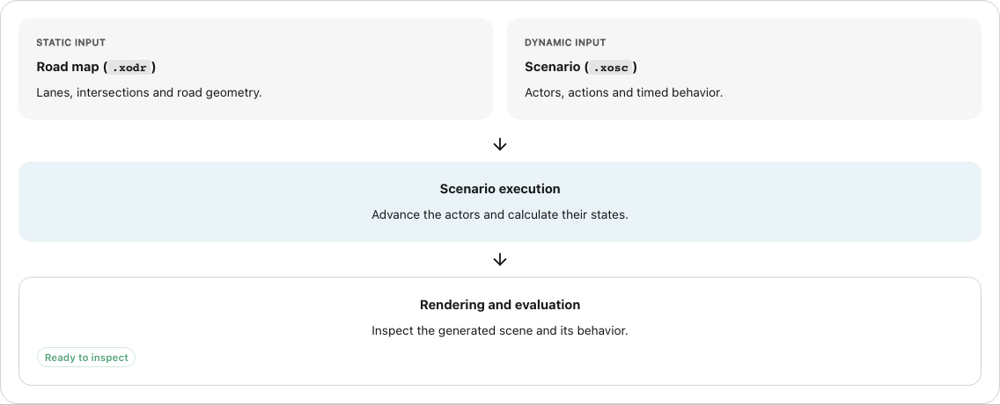

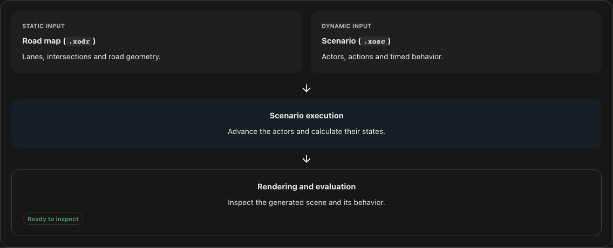

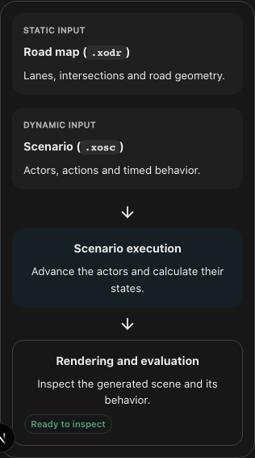

Site icons load automatically as reading-list links come into view. Failed loads
show a retry control. Hover over a conversation link or focus it with the keyboard
to inspect its destination and copy the URL. HTML and
offline exports keep a local icon marker.

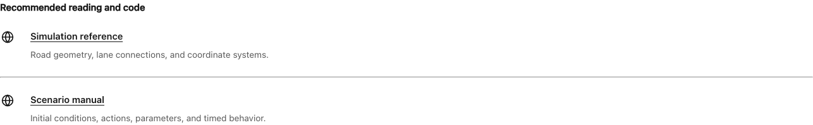

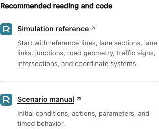

XML examples keep tag names, attributes and strings visually distinct. Link
previews show the destination URL and provide a copy button.

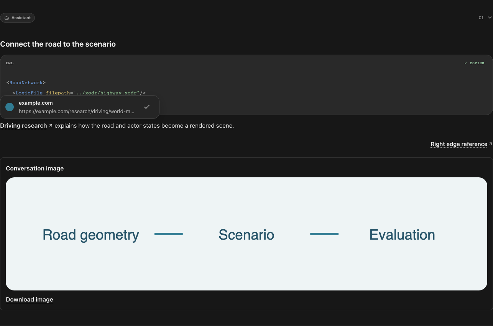

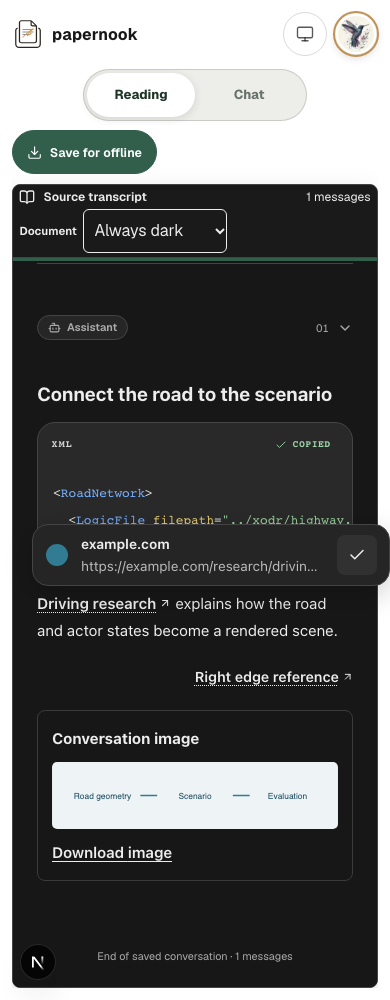

#### Imported content coverage

The source must include the content or a usable attachment URL. A feature being
visible in the original chat does not establish that its share includes the file
or application behind it.

| Content                                              | Current support                                                                                                                      |
| ---------------------------------------------------- | ------------------------------------------------------------------------------------------------------------------------------------ |
| Markdown, code, formulas, lists and tables           | Rendered, including HTML tables and supported provider table blocks.                                                                 |
| Cards, columns, flow arrows and reading lists        | Native layouts with responsive spacing and headings.                                                                                 |
| Site icons                                           | Compact icons load when visible, with manual retry if a request fails.                                                               |
| Images                                               | Supported embedded images and provider attachments. Arbitrary Markdown image URLs remain links.                                      |
| SVG, Mermaid and Three.js                            | Isolated previews for recognized diagrams and code.                                                                                  |
| HTML applications                                    | Isolated previews with included scripts and styles. External script dependencies are unsupported.                                    |
| React/JSX artifacts                                  | Source is preserved. React artifact previews are unsupported.                                                                        |
| Charts and maps                                      | Supported as images, SVG, Mermaid or included HTML. Dedicated chart specifications and provider map widgets have no native renderer. |
| PDF, Word, spreadsheets, presentations and notebooks | Available as downloads when attached. Conversation attachment previews are unsupported.                                              |
| Audio and video                                      | Players for supported attachments and MIME types. Raw PCM and additional provider media encodings need conversion.                   |
| Citations                                            | Supported source links and ChatGPT citation metadata. Other providers' structured document locations and annotations need adapters.  |
| Quizzes, flashcards, simulations and dashboards      | Can render as included HTML. Native provider Canvas state and connected services are unsupported.                                    |
| Other provider share URLs                            | ChatGPT and Claude share links are supported. Other services need a compatible transcript export.                                    |

Portable exports retain native layouts, formulas and saved attachments.
Interactive HTML, Mermaid and Three.js previews retain their source.

The output categories are documented in [ChatGPT Visualizations](https://learn.chatgpt.com/docs/visualizations),
[ChatGPT file previews](https://learn.chatgpt.com/docs/artifacts-viewer),
[Claude artifacts](https://support.claude.com/en/articles/17153992-what-are-artifacts-and-how-do-i-use-them)
and [Gemini Canvas](https://support.google.com/gemini/answer/16047321?hl=en).
The table describes Papernook's current support for those categories.

### Read without internet

While online, open a paper or conversation and choose **Available offline**.
Wait for **Saved on this device** before disconnecting. A paper download includes
its current PDF, extracted text, summary and your saved chats. A conversation
download includes its source transcript and saved follow-ups. Approved local chat
attachments are embedded; external image links are not fetched automatically.

Use **Downloads** to inspect the saved library. When the server is unreachable,
Papernook opens this library automatically. Downloaded papers and conversations
remain in separate tabs with their own categories and search. You can read a PDF,
its text and existing chats, or export HTML and PDF files. Sending AI questions
and editing annotations require a connection. The reader restores the online
document when connectivity returns and the profile session is still valid.

**Settings → Offline storage** lists downloaded items, their sizes and save dates.
Update a download to capture recent changes, remove individual items, or choose
**Clear all downloads**. These controls only remove device copies. They do not
delete documents or conversations from the server. While the app is open online,
downloads older than 15 minutes are refreshed; update failures are shown and keep
the last complete copy.

Downloads live in browser-managed storage on this device. They are not a visible
folder in the phone's Files app. Export PDF or HTML to keep independent files.
Changing profiles or logging out clears private downloads, including in other
open tabs. Browsers may reclaim stored data when the device is low on space.
Offline support requires HTTPS (or localhost for development) and a browser that
supports service workers and IndexedDB. Install Papernook on your home screen
and open Downloads once before a trip to check the documents you need.

### Add a paper

- **From anywhere:** copy an arXiv/OpenReview URL, direct PDF URL, or publisher
  page that exposes a PDF link; paste it into **Add paper**, then select
  **Add paper**.
- **From Safari or Chrome on desktop:** install the
  [browser extension](../extension/README.md) to redirect supported PDFs
  automatically or use its toolbar button anywhere. Settings retains a
  bookmarklet fallback for managed browsers that cannot install extensions.
- **From an iPhone or iPad:** Share → **Add to papernook**. Install it once
  from **Get the Shortcut**; see the [Shortcut guide](shortcut.md). The same
  Shortcut works from Safari's Share menu on a Mac.

Papernook opens a confirmation page with the proposed topic, tags, summary,
related papers, and starter questions. Review it and select
**Accept into library**.

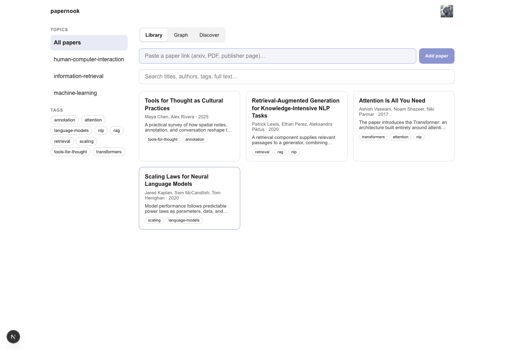

### Read, annotate, and ask

Open a library card to put the PDF and its chat side by side. Ask a starter
question, continue an earlier conversation, or paste a marked-up screenshot
and ask what it means.

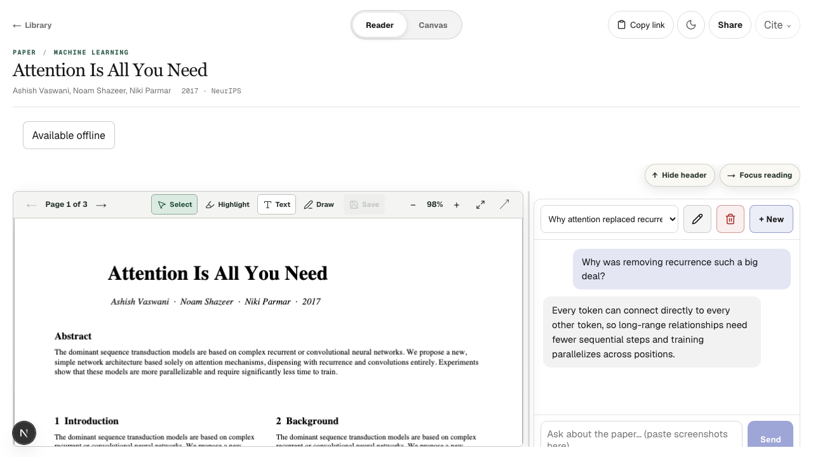

On desktop, select **Focus reading** to give the PDF the full workspace and
**Show chat** to restore it. On a tablet, use the persistent **Reading** and
**Chat** tabs.

Use **Document** in the reader toolbar to choose light or dark pages. Dark
appearance recolors text and vector drawings while keeping embedded images in
their original colors. Some PDF effects may render differently; choose
**Always light** to see the original page. The PDF file itself is unchanged.

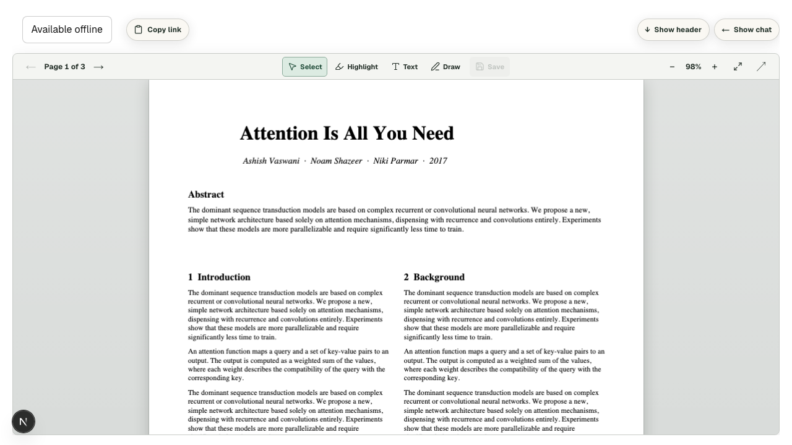

Switch to **Canvas** to arrange notes, drawings, screenshots, links, and video
beside the same paper conversation. Canvas keeps its own shared objects while
the annotated PDF remains the source of truth in Reader.

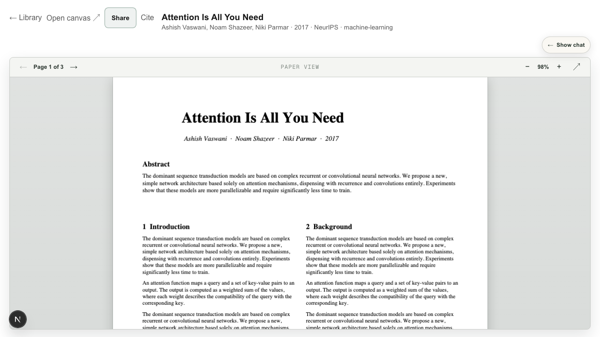

To write with Apple Pencil, open the paper in Safari and start drawing.
Papernook enables Draw for pen input and autosaves into the PDF. WebDAV is
available as optional external-app compatibility; see the
[iPad annotation guide](ipad-annotation.md).

### Explore

- Open **Graph** to move through connections among papers, authors, topics,
  tags, and related readings.
- Open **Discover** for AI suggestions of papers you do not have yet, grounded
  in the library. Each suggestion carries its source link, so adding one runs
  the same capture flow as any other paper.

### Share a reading

Select **Share** on a paper, choose a mode, then **Create link & copy**.
The public link is view-only and revocable. The current annotated PDF is
included; conversation snapshots stay off unless you select them.

No login is required to open the link. Its unguessable share id is the
capability to read that one shared paper.

The sharing dialog offers three modes:

| Mode             | What the recipient can do                                                                            |
| ---------------- | ---------------------------------------------------------------------------------------------------- |
| View only        | Read the current annotated PDF and selected conversation snapshots without an account.               |
| Independent fork | Import the PDF and selected snapshots into another Papernook. Future edits stay separate.            |
| Collaborate      | Request approval to sync annotations, the canvas, exercises, and explicitly published conversations. |

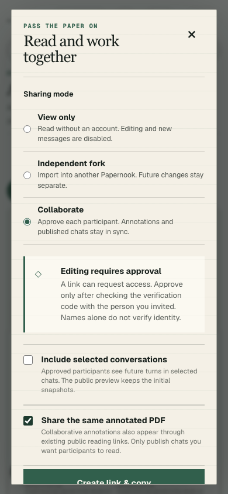

For a fork or collaboration, the recipient enters their Papernook address on
the shared reading and opens its import page. They choose a topic and import
mode. The receiving server needs a valid HTTPS connection to the source.
Forks preserve the annotated PDF and selected chat images. **Include canvas and
exercise snapshots** also copies the saved canvas, its uploaded media, exercise
markdown, and annotated exercise PDF. This option starts enabled for forks.
They exclude private
chats, instance credentials, capture tokens, integration settings, and sharing
permissions. Revoking a link cannot recall an imported or downloaded copy.

For collaboration, compare the recipient's verification code with the code in
**Share → Manage participants** before approving access. A requested name does
not establish identity. Each approved credential belongs to one paper and one
profile on the receiving instance. The owner can revoke it from the same panel.
Revoked credentials cannot be approved again; the reader must request access
with a new credential.

Approved browser edits go to the owner's canonical PDF. New annotations carry
the approved contributor's name. Contributors can edit or delete their own
annotations; conflicting saves require a reload. The server reconstructs
supported text, highlight, and ink annotations from validated values. It never
copies a contributor's PDF page content, actions, fonts, or appearance streams.
Signed PDFs cannot be rewritten, and collaborative PDFs are limited to 32 MB.
Annotation processing runs in a separate process with a restricted filesystem,
a 15-second timeout, a bounded heap, and explicit decompression allocation
limits. Unsupported or oversized edits fail before replacing the canonical PDF.

Approved participants also share the canvas and exercises. Canvas changes carry
their creator and latest editor; selecting an object shows its latest editor.
Concurrent saves require a reload and preserve unsaved changes. Shared canvases
support uploaded images and videos, text, drawings, and HTTP or HTTPS links.
Remote embeds, bookmarks, session records, and external media sources are
rejected. Canvas documents are limited to 4 MB, each media upload to 8 MB, and
referenced media to 32 MB per canvas.

Open **Exercises** beside the reader to save a question or open its annotated
PDF. New exercises show the contributor's approved name. Generation appends
pages, preserving existing ink and page coordinates. A paper can share up to
100 exercises and 2 MB of markdown, with a 32 MB exercise PDF limit. Retrying
an interrupted save recovers the accepted operation without adding it twice.

Open **Collaboration** beside the reader to publish one of your conversations.
**Publish and sync** shares its current content and future turns with approved
participants. **Stop sharing conversation** withdraws the shared copy. Personal
chats remain private until published. Each instance uses its own configured AI
provider; collaboration credentials cannot run AI jobs on the source server.

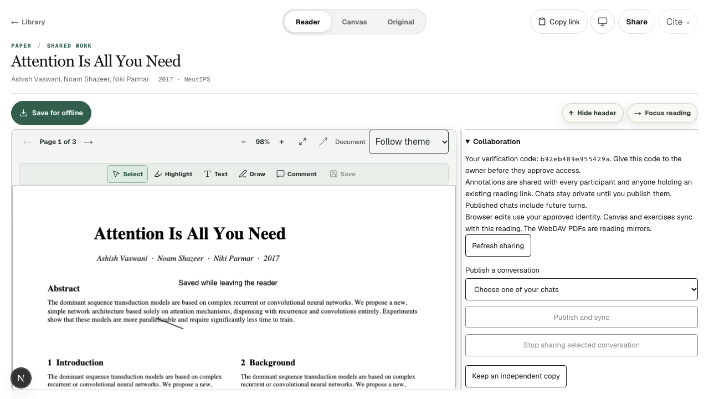

Each collaboration holds at most 100 published conversations and 32 MB of
conversation data, with an 8 MB limit per conversation. A failed refresh keeps
the last published revision and shows a sync error. Private conversations can
continue; withdraw an oversized publication before sharing it again.

The public preview keeps the conversation snapshots selected when the link was
created. Canvas and exercise snapshots require their own inclusion checkbox;
approval always enables their live collaboration independently of that checkbox.
The public canvas and exercise PDF have no editing tools, and conversations
cannot be continued. Later collaborative annotations appear in the same live paper PDF, including
through existing public reading links. Both parties confirm that visibility
before connecting.

The receiving instance refreshes its PDF, canvas, exercises, and published conversations
every 30 seconds. WebDAV cannot identify individual editors, so its mirror is
for reading. Unexpected local edits are preserved as conflicts and are never
uploaded under someone else's name. **Keep an independent copy** stops syncing
and retains the local artifacts and personal chats. Interrupted mirror writes
have a durable recovery record. Recovery accepts only the expected files or
the already committed replacements; conflicting local edits remain untouched.

Sharing blocks private network destinations by default. An administrator can
allow an exact private HTTPS origin with
`PAPERNOOK_SHARING_TRUSTED_ORIGINS=https://papers.internal.example`.
Comma-separated entries may include explicit ports. TLS validation remains
enabled, DNS is pinned for each request, and authenticated requests never
follow redirects. Keep this list limited to Papernook servers you trust.

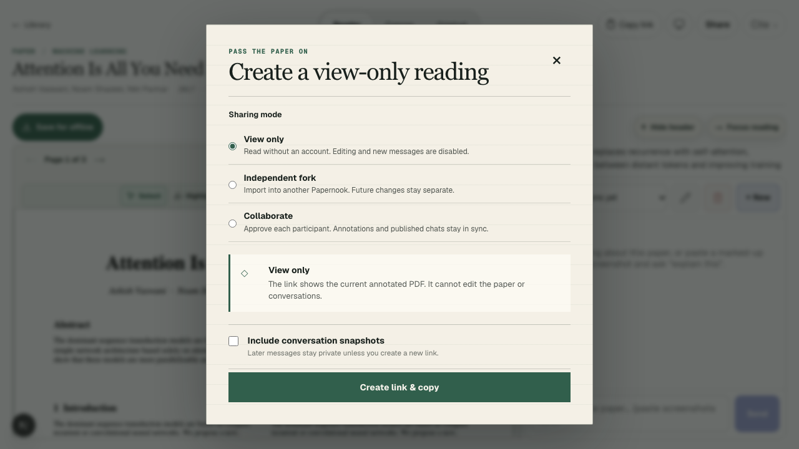

## Share household access

First choose the route that matches your server:

| Your setup                                             | Use this flow                            |
| ------------------------------------------------------ | ---------------------------------------- |
| Papernook opens at an HTTPS domain from any browser    | [Custom domain](#option-a-custom-domain) |
| Papernook is reachable only after connecting Tailscale | [Tailscale](#option-b-tailscale)         |

The result is the same in both cases:

- **Shared:** papers, folders, tags, annotations, and exercises.
- **Organized by profile:** chats, capture token, and Zotero connection.
- **One authority:** Sidedoor manages the shared password, passkeys, and sessions.

The first profile is Admin. One shared password admits readers, who then choose
their own profile. Papernook offers to save a passkey with Apple Passwords or
another WebAuthn manager after password entry. This step is optional. A saved
passkey opens the picker on later visits. Anyone admitted can choose Admin and
manage settings; choosing another profile removes that access. Admin can revoke
passkeys in App access. The entry screen shows only Password and Continue;
there is no account name to enter.

### Option A: custom domain

Before sharing access, the server owner should finish
[public exposure hardening](public-exposure.md) and register a passkey.

1. Open Papernook through its public URL, such as
   `https://papernook.example.com`.
2. Send the app URL and shared password through a secure channel.
3. Your friend enters the password, selects **Add profile**, and chooses a name
   and animal. They can save a passkey on their device for later visits.
4. They follow the welcome screen.

> **Expected result:** the new profile opens its own welcome flow with a
> personal capture token and reader setup.

### Option B: Tailscale

Production sessions require HTTPS, so publish the app through Tailscale Serve
instead of sending raw port `3000`:

1. On the Papernook server, run:

   ```bash
   tailscale serve --bg 3000
   tailscale serve --bg --tcp=8080 tcp://127.0.0.1:8080
   tailscale serve status
   ```

   The status output gives the app an HTTPS `.ts.net` URL and keeps WebDAV on
   port `8080`.

2. In the [Tailscale Machines page](https://login.tailscale.com/admin/machines),
   open the Papernook server, select **Share**, and send the generated link or
   email invitation.
3. Your friend accepts it and installs Tailscale on each device that will use
   Papernook.
4. Send the HTTPS app address from `tailscale serve status`, such as
   `https://papernook-server.example-tailnet.ts.net`.
5. Share the household password securely. They open the address, enter the
   password, choose **Add profile**, and follow the welcome screen.
6. For iPad annotation, use
   `http://papernook-server.example-tailnet.ts.net:8080` as the WebDAV address
   and share the common `WEBDAV_USER` and `WEBDAV_PASS` securely.

If MagicDNS does not resolve a shared machine's short name, use its full
`<hostname>.<tailnet>.ts.net` name or Tailscale IP. If the person is already a
trusted member of your tailnet, skip the machine-sharing step and send the
address.

Machine sharing limits access to that machine. Inviting a user to the tailnet
can expose more devices and services unless your access controls restrict
them; see Tailscale's
[inviting-versus-sharing guide](https://tailscale.com/docs/reference/inviting-vs-sharing)
and [machine-sharing steps](https://tailscale.com/docs/features/sharing).

> **Using a domain and Tailscale together?** Authentication is identical on
> the public hostname and the Tailscale Serve hostname. Host headers never
> disable authentication.

### If a friend cannot connect

1. Confirm they can open the app URL before setting up WebDAV.
2. For Tailscale, confirm the shared machine appears online in their Machines
   list and try its Tailscale IP.
3. Verify they have the current household password.
4. For Tailscale, run `tailscale serve status` and open the listed HTTPS URL.
   For a domain, confirm HTTPS reaches Caddy.
5. Test WebDAV separately with the URL for the same route and verify the
   `WEBDAV_USER` and `WEBDAV_PASS`.

View or rotate your personal capture token at any time in **Settings**.

## Delete a profile and its per-profile data

Every reader can open **Settings → Delete my profile**, type their username,
and erase their own personal data. An admin can use **Settings → Members** to
remove another reader completely.

Deletion removes the profile, session access, capture token, Zotero
configuration and cursor, chats, pasted chat crops, unconfirmed captures,
owned share links, and stored login-rate state. Confirmed PDFs, annotations,
canvases, exercises, summaries, and metadata remain part of the shared
library; the deleted username is removed from their capture attribution. If
the admin deletes their own profile, the oldest remaining profile becomes the
admin. Deletion waits for active capture and Zotero work to stop and clean up,
and revokes that profile's sessions on every device.
